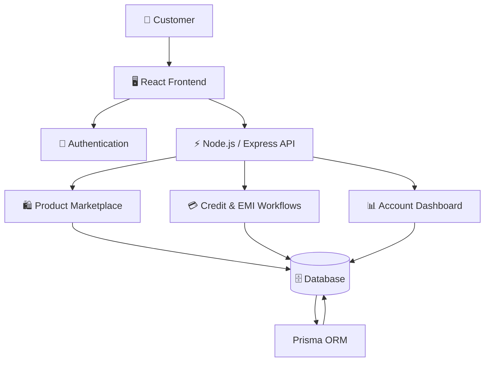
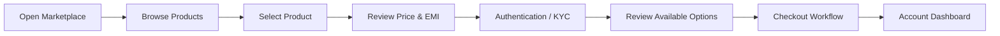
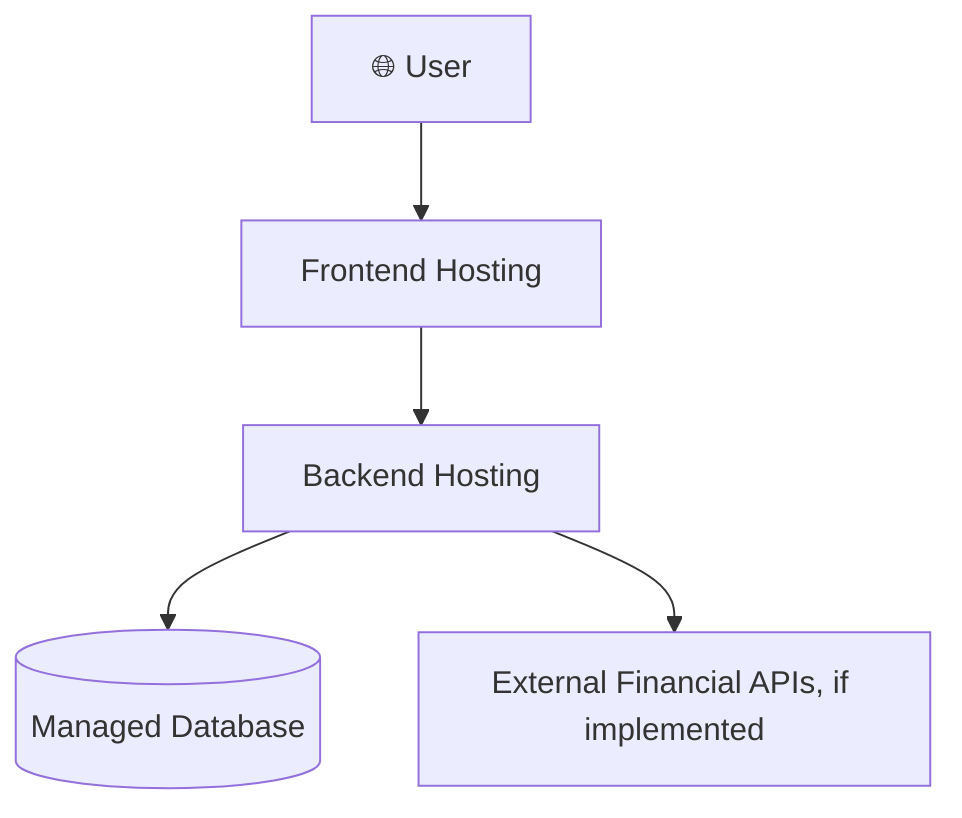

# 💳 1Fi Marketplace — Smart Shopping Meets Fintech

<p align="center">
  
</p>

<p align="center">
  
</p>

<p align="center">
  
  
  
  
</p>

<p align="center">
  <strong>A fintech marketplace concept that brings product discovery, flexible EMI shopping, and mutual-fund-backed credit concepts into one digital experience.</strong>
</p>

<p align="center">
  <a href="#-overview">Overview</a> •
  <a href="#-features">Features</a> •
  <a href="#-architecture">Architecture</a> •
  <a href="#-installation">Installation</a> •
  <a href="#-roadmap">Roadmap</a>
</p>

---

## 🌌 Overview

**1Fi Marketplace** is a full-stack marketplace concept that combines e-commerce with fintech-inspired payment flexibility.

The application explores how customers could discover products, understand EMI options, manage a shopping experience, and view a credit-line dashboard connected conceptually to mutual-fund-backed lending.

Instead of treating shopping and financing as separate experiences, the platform brings them together in one interface.

### ✨ The Core Idea

<table>
<tr>
<td width="33%" align="center">

### 🛍️ Shop

Discover products through a modern marketplace interface.

</td>
<td width="33%" align="center">

### 💳 Finance

Explore credit-line and EMI concepts within the shopping journey.

</td>
<td width="33%" align="center">

### 📊 Manage

Review account activity, loan information, and repayment details.

</td>
</tr>
</table>

> **Project scope:** This repository represents a software project/prototype. Financial integrations, actual credit approval, payment processing, and mutual fund lien operations should not be considered live unless independently implemented and verified.

---

## 🚀 Features

### 🛍️ 1. Product Marketplace

- Product catalog and browsing experience
- Product details and pricing
- Shopping-oriented interface
- Integration points for a cart and checkout flow
- Product discovery designed around a modern e-commerce experience

### 💰 2. Flexible EMI Shopping

- EMI-oriented product purchasing concept
- Display of payment options
- Financing information integrated into the shopping journey
- Foundation for future installment and repayment workflows

### 💳 3. Mutual-Fund-Backed Credit Concept

The project explores a lending workflow inspired by credit lines secured against eligible mutual fund investments.

```text
                 CUSTOMER
                    │
                    ▼
           Explore Marketplace
                    │
                    ▼
            Select a Product
                    │
                    ▼
           Explore Credit / EMI
                    │
                    ▼
         Review Financing Details
                    │
                    ▼
           Continue Checkout Flow
```

Actual eligibility checks, lien creation, lender integrations, and loan disbursement require real financial service integrations and applicable regulatory controls.

### 🔐 4. Authentication and KYC Flow

- User account interface
- Authentication workflow
- KYC-oriented onboarding concept
- Account-specific dashboard experience

### 📊 5. Customer Dashboard

- Credit-line information
- Loan and repayment overview
- Account activity
- Financing-related status information

### 🧑‍💼 6. Administrative Capabilities

Where implemented, administrative workflows can support product management, catalog maintenance, and marketplace operations.

---

## 🎬 Animated Project Showcase

<p align="center">
  
</p>

<table>
<tr>
<td width="50%" align="center">

### 🛒 Marketplace Experience

Discover products and explore a shopping workflow.

</td>
<td width="50%" align="center">

### 💳 Financing Experience

Understand how financing options could fit into checkout.

</td>
</tr>
<tr>
<td width="50%" align="center">

### 📈 Credit Dashboard

Review credit-related information in one place.

</td>
<td width="50%" align="center">

### 🔄 Repayment Workflow

Explore repayment tracking and account management concepts.

</td>
</tr>
</table>

> Add real screenshots or a GIF of your application to turn this section into a visual product demo.

---

## 🏗️ Architecture



### Architecture Layers

| Layer | Responsibility |
|---|---|
| Frontend | Marketplace UI, forms, dashboard, and user interactions |
| API | Request handling and application business logic |
| Authentication | User identity and protected access |
| Marketplace | Product catalog and shopping workflows |
| Fintech workflows | Credit and EMI-related application concepts |
| ORM | Structured database access through Prisma |
| Database | Persistent application data |

The diagram describes the intended application organization; exact service boundaries depend on the implementation in the repository.

---

## 🔄 Application Workflow



---

## 🧰 Technology Stack

### Frontend

<p>
  
</p>

- React
- JavaScript / TypeScript, depending on the configured frontend
- Responsive component-based UI
- Marketplace and dashboard components

### Backend

<p>
  
</p>

- Node.js
- Express.js
- REST API architecture
- Authentication and business logic

### Database and ORM

<p>
  
</p>

- Prisma ORM
- SQLite for local development, where configured
- PostgreSQL as a potential production database option

### Development Tools

<p>
  
</p>

- Git and GitHub
- Visual Studio Code
- Vercel
- Docker, if configured for the deployment workflow

---

## 🗃️ Database Design

The database should reflect the entities actually implemented in the project.

A typical marketplace and financing model may include:

| Entity | Purpose |
|---|---|
| User | Account and profile information |
| Product | Marketplace catalog |
| Order | Customer purchases |
| CreditLine | Credit-related account information |
| Loan | Financing record |
| Repayment | Installment and repayment history |
| KYCRecord | Verification workflow status |

These are conceptual entities, not a guarantee that every model exists in the current Prisma schema. Refer to the actual schema for the authoritative database design.

---

## 🔌 API Design

The backend can expose REST endpoints for the following functional areas, depending on the routes implemented in the repository.

| Functional Area | Typical Operations |
|---|---|
| Authentication | Register, login, profile |
| Products | List, view, create, update |
| Cart and Orders | Manage cart, create and view orders |
| Credit | View credit-line information |
| EMI and Loans | Review financing and loan details |
| Repayments | View repayment history and status |
| Administration | Manage products and authorized operations |

### Example Request

```http
GET /api/products
Accept: application/json
```

### Example Response

```json
{
  "success": true,
  "data": [
    {
      "id": "product-example",
      "name": "Example Product",
      "price": 24999
    }
  ]
}
```

This is an illustrative API example. Use the actual route names and response formats from your backend implementation.

---

## 🔐 Security Considerations

Financial applications require security beyond a polished UI.

Recommended safeguards include:

- Secure authentication and password hashing
- Server-side authorization for protected endpoints
- Input validation and safe error handling
- Environment variables for credentials and secrets
- Rate limiting and abuse prevention
- Secure cookie configuration when cookie-based authentication is used
- Protection against unauthorized account and order access
- Audit logging for sensitive financial actions
- No real financial or KYC data in public demo environments

**Never commit API keys, database passwords, JWT secrets, or production credentials to GitHub.**

---

## 💻 Installation

### Prerequisites

- Node.js and npm
- Git
- A configured database supported by the project's Prisma schema

### 1. Clone the Repository

```bash
git clone YOUR_EXISTING_REPOSITORY_URL
cd YOUR_PROJECT_DIRECTORY
```

Replace the placeholders with your existing repository URL and folder name.

### 2. Install Dependencies

If the project has a single package:

```bash
npm install
```

If frontend and backend use separate packages, install dependencies in each directory:

```bash
cd backend
npm install
```

```bash
cd ../frontend
npm install
```

Use the actual directory names in your repository.

### 3. Configure Environment Variables

Create the appropriate `.env` file using your project's environment example.

Typical variables may include:

```env
DATABASE_URL="your_database_connection_string"
JWT_SECRET="replace_with_a_secure_random_secret"
PORT=5000
```

These are illustrative variable names. Match the exact names expected by your application code and Prisma configuration.

### 4. Configure Prisma

If the repository uses Prisma migrations, run the commands appropriate for its configured Prisma version and schema:

```bash
npx prisma generate
npx prisma migrate dev
```

If your project uses `prisma db push` during development, follow its existing setup instructions instead of applying migrations blindly.

### 5. Start the Application

Use the scripts defined in the relevant `package.json` files:

```bash
npm run dev
```

For a separate frontend and backend, start each using its own configured development script.

---

## 🧪 Testing and Quality

Recommended checks for a marketplace application include:

- Authentication and authorization tests
- Product catalog validation
- Cart and order calculations
- EMI calculation validation
- API error handling
- Database persistence
- Responsive frontend behavior
- Protected-route access
- Environment configuration checks

Use the test framework and commands already configured in your repository.

---

## ☁️ Deployment

A possible deployment arrangement is:



### Deployment Checklist

- Configure frontend and backend environment variables.
- Use HTTPS in production.
- Configure CORS for trusted origins.
- Use a production database where appropriate.
- Apply the correct Prisma schema/migrations.
- Store secrets in the hosting provider's secret manager.
- Test authentication and protected endpoints after deployment.
- Do not represent simulated financing flows as live financial services.

---

## 📸 Screenshots

Create a `screenshots/` directory in your repository and add real screenshots of the running application.

```text
screenshots/
├── homepage.png
├── marketplace.png
├── product-details.png
├── login.png
├── dashboard.png
└── repayment.png
```

Display them in the README:

<p align="center">
  <strong>🏠 Marketplace Homepage</strong>
</p>

<p align="center">
  
</p>

<p align="center">
  <strong>🛍️ Product EMI Page </strong>
</p>

<p align="center">
  
</p>

<p align="center">
  <strong>📊Dashboard Page</strong>
</p>

<p align="center">
  
</p>


---

## 🛣️ Roadmap

- [ ] Improve product discovery and filtering
- [ ] Enhance mobile shopping experience
- [ ] Expand order and cart management
- [ ] Add validated EMI calculation workflows
- [ ] Improve dashboard analytics
- [ ] Add comprehensive backend tests
- [ ] Strengthen authentication and authorization
- [ ] Improve accessibility
- [ ] Add structured logging and monitoring
- [ ] Integrate external financial services where eligible and supported
- [ ] Document production deployment and database migrations

---

## 🧠 What This Project Demonstrates

- Full-stack application development
- E-commerce workflow design
- REST API development
- Database modeling and ORM usage
- Authentication and account management
- Fintech product workflow design
- Frontend/backend integration
- Environment-based configuration
- Deployment planning and security awareness

---

## 👨‍💻 Developer

**Dhanush Gopi Kavala**

Full-Stack Developer | Software Engineering Graduate

<p align="center">
  <a href="https://github.com/dhanushgopi2456">
    
  </a>
  <a href="https://www.linkedin.com/in/dhanush-gopi-kavala-a460a528b/">
    
  </a>
</p>

---

<p align="center">
  
</p>

<p align="center">
  <strong>💳 1Fi Marketplace</strong><br/>
  <em>Bringing shopping and flexible financing concepts together.</em>
</p>
